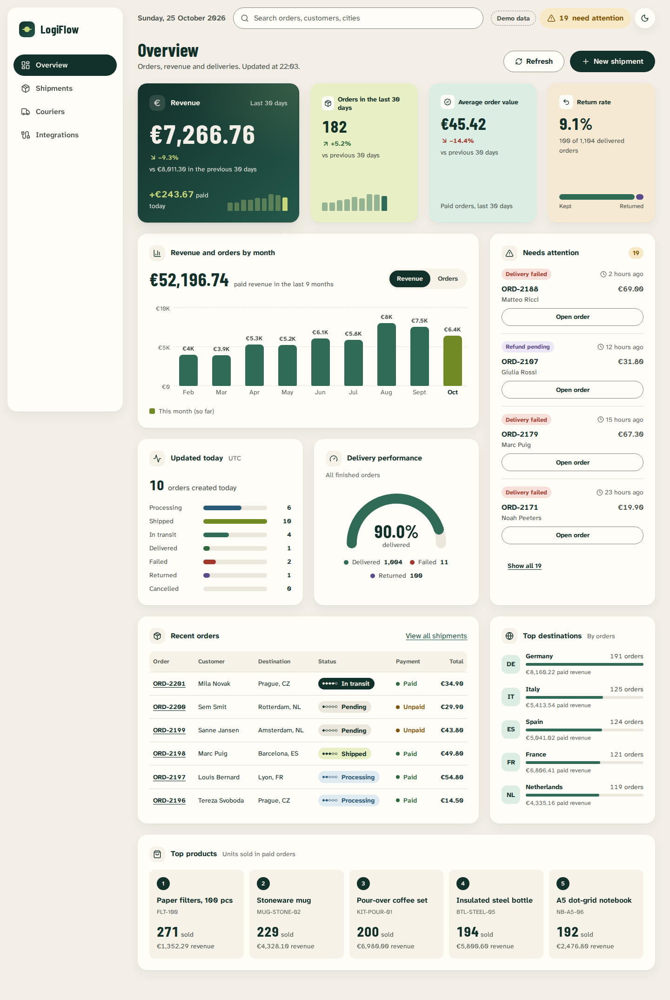
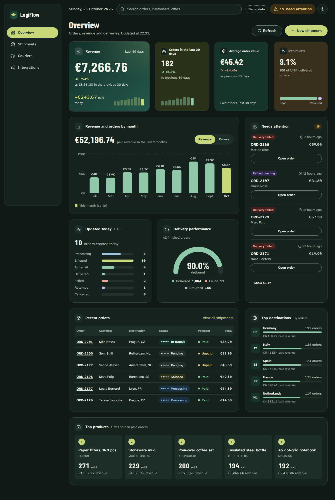
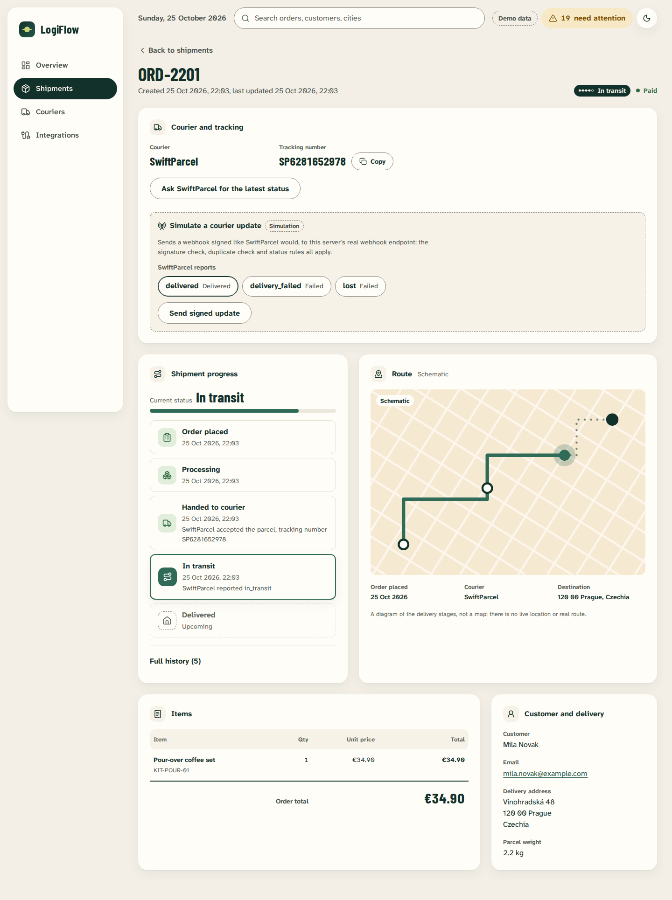
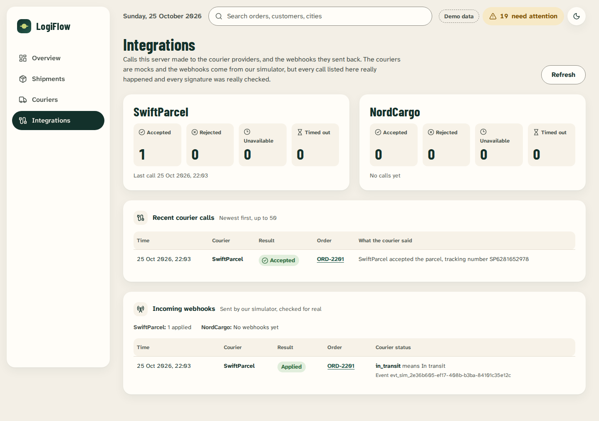
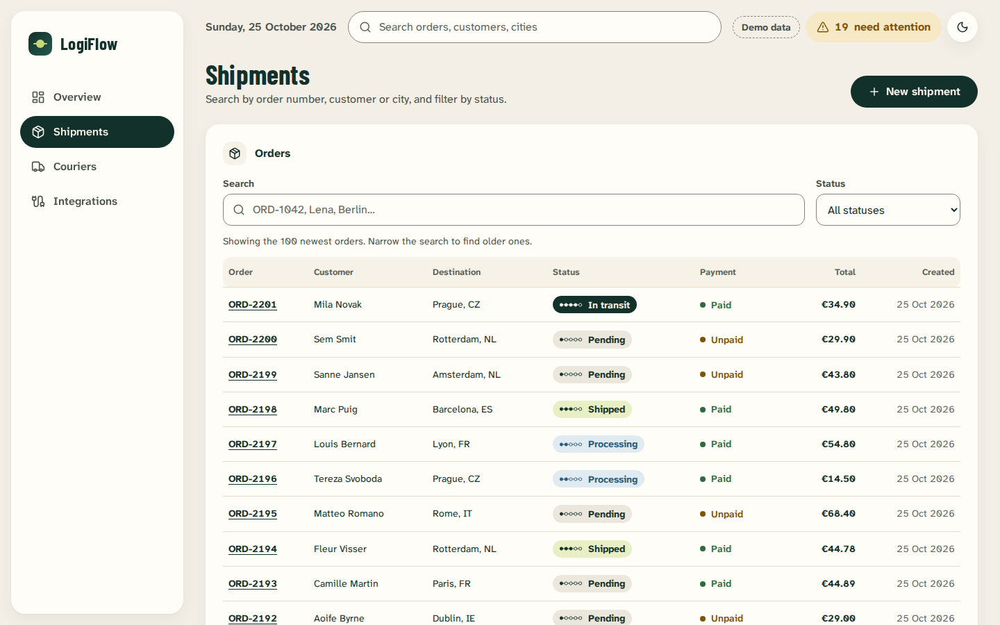
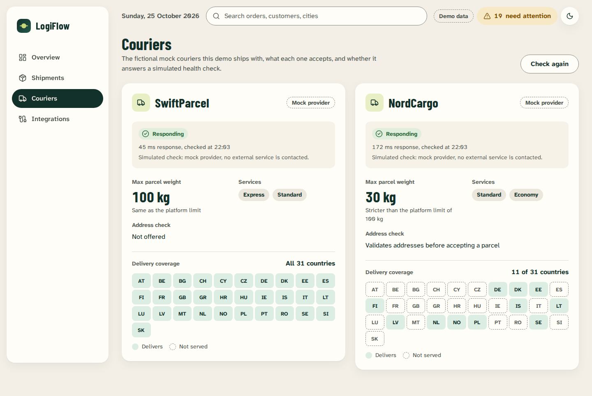
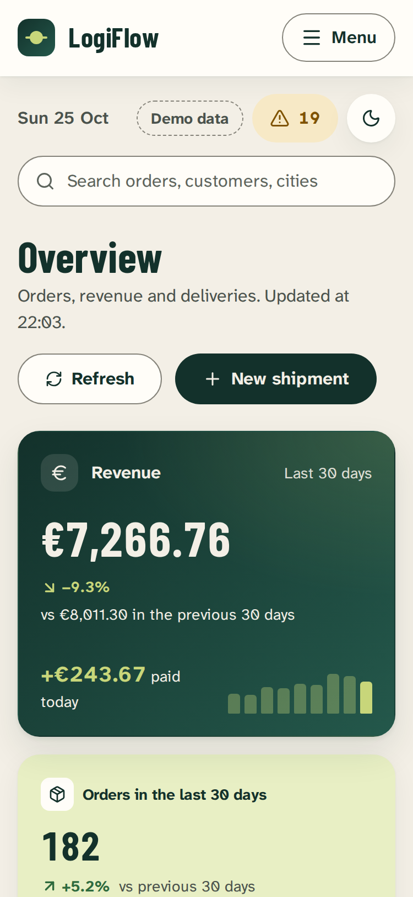
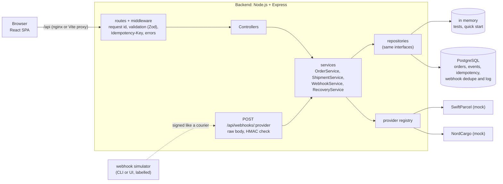

# LogiFlow: Courier Integration Platform

[](https://github.com/natiwork/courier-integration-platform/actions/workflows/ci.yml)

A full-stack app for managing e-commerce orders and handing them to courier services: Node.js + TypeScript + Express + PostgreSQL on the backend, React + TypeScript on the frontend.

**What it demonstrates:** integrating unreliable external services safely. Orders move through a strict state machine, and every change is recorded as an event. Couriers sit behind one provider interface, with timeouts, bounded retries and idempotency keys. Signed courier webhooks are verified for real. Concurrent requests, even from two server processes, can't ship an order twice. The couriers are fictional mocks and the webhooks come from a built-in simulator; both are labelled as such everywhere ([limitations](#limitations)).

| Overview (light) | Overview (dark) |
|---|---|
|  |  |
| **Order details** with the shipment timeline and the webhook simulator | **Integrations**: calls made to the mock couriers and the checked webhooks |
|  |  |
| **Shipments** with search and status filter | **Couriers** with capabilities and coverage |
|  |  |

<p align="center"></p>

## Quick start

With Docker (PostgreSQL, the API and the web app; demo data included):

```bash
cp .env.example .env && docker compose up --build
```

Then open <http://localhost:8080>. If port 5432 (another PostgreSQL) or 8080 is already in use, change `POSTGRES_PORT` or `APP_PORT` in `.env` first. The backend applies the database migrations on start and fills an empty database with ~1,200 invented demo orders. Stop with `Ctrl+C`; the data stays in a Docker volume (`docker compose down -v` removes it).

For local development (Node 24 via `.nvmrc`, hot reload, no Docker needed):

```bash
cd backend && npm install && npm run dev      # API on :3000, in-memory storage with demo data
cd frontend && npm install && npm run dev     # app on http://localhost:5173 (second terminal)
```

To develop against PostgreSQL instead, see [docs/storage.md](docs/storage.md#local-development-without-docker-for-the-app).

## Architecture



Layers only talk downwards: routes → controllers (HTTP only) → services (business rules, no Express) → repositories or courier providers. The services don't know whether data is in memory or in PostgreSQL.

## Key engineering decisions

- **State machine + event log.** One transition table decides every status change (`PENDING → PROCESSING → SHIPPED → IN_TRANSIT → DELIVERED`, plus `FAILED`, `CANCELLED`, `RETURNED`); anything else is `409`. Every change writes an `OrderEvent` in the same transaction, so each order has an audit trail. → [docs/state-machine.md](docs/state-machine.md)
- **Courier provider abstraction.** Each courier implements one `CourierProvider` interface and answers with a `success | transient | permanent` result instead of throwing. Each courier translates its own status codes. A new courier is a new file plus one registry line. → [docs/courier-providers.md](docs/courier-providers.md)
- **Timeouts and bounded retries.** Every courier call has a deadline (`AbortController`). Only "try later" answers are retried: up to 3 attempts with exponential backoff and jitter. A timeout is never retried automatically, because the courier may already have created the shipment. → [docs/reliability.md](docs/reliability.md)
- **Idempotency.** `Idempotency-Key` on order creation and shipping. The first request claims the key atomically (`INSERT … ON CONFLICT`), and a retry gets the stored answer instead of a second order. → [docs/reliability.md](docs/reliability.md#idempotency-key)
- **Verified webhooks.** HMAC-SHA256 over `timestamp.rawBody`, compared with `timingSafeEqual`. Stale timestamps are rejected, and events are deduplicated by `(provider, event id)`. → [docs/webhooks.md](docs/webhooks.md)
- **Atomic conditional updates.** Read, check the rules, then `UPDATE … WHERE status = <what was read>`. If another request was faster, nothing is written and the caller gets `409`. A shipping lock column, separate from the status, keeps a second server process from shipping the same order. Tests prove this against a real database with two app instances. → [docs/state-machine.md](docs/state-machine.md#status-vs-shipping-lock)
- **Crash recovery.** A ship request interrupted by a crash leaves its lock behind. A recovery job closes it after 5 minutes as `FAILED`, with an event telling the operator to check with the courier. A transactional outbox is described as the bigger alternative. → [docs/reliability.md](docs/reliability.md#a-crash-while-waiting-for-the-courier)
- **Plain SQL with versioned migrations.** The `pg` driver with parameterized queries, `CHECK`/`UNIQUE`/foreign-key constraints and indexes for the real queries. The same repository contract tests run against both storages. → [docs/storage.md](docs/storage.md)
- **Honest UI.** Every number comes from the API, and money is integer cents. Every widget has its own loading, empty and error state. Both themes meet WCAG AA contrast, and the app works with the keyboard alone and from 375 px up. → [docs/frontend.md](docs/frontend.md)

## Tests

| Layer | What | Run |
|---|---|---|
| Unit + API | Backend services, state machine, providers, retries, webhooks, HTTP contract via Supertest (in memory). 360 tests | `cd backend && npm test` |
| Integration | The same repository contracts on real PostgreSQL, transactions, rollback, constraints, seed, concurrency with two app instances. 53 tests | `docker compose up -d db`, then `cd backend && npm run test:integration` |
| Frontend unit | Money parsing, form validation rules, courier coverage, timeline stages. 95 tests | `cd frontend && npm test` |
| End-to-end | Playwright in Chromium: dashboard, search, order form, pay and ship, courier limits, webhook simulator, error recovery, mobile. 11 tests | `cd e2e && npm install && npm run test:e2e` |

Tests were also mutation-checked: the guarded line was broken on purpose, and the test had to fail. CI runs all four layers on every push and pull request ([workflow](.github/workflows/ci.yml)). The e2e report is uploaded when a test fails. More on the e2e setup in [docs/testing.md](docs/testing.md).

## Tech stack

Node.js 24, TypeScript (strict), Express 5, Zod, PostgreSQL 18 (`pg`), Vitest, Supertest · React 19, React Router, Vite, CSS Modules, lucide icons · Playwright · Docker Compose, nginx · GitHub Actions.

## Limitations

- **The couriers are mocks.** SwiftParcel and NordCargo are fictional and run inside the backend, with simulated delays, outages and a simulated health check. No real courier API is called.
- **The webhooks are simulated.** The signature check, replay window, deduplication and status rules are real, but the requests come from our simulator (CLI or the labelled "Simulate a courier update" box), not from a courier.
- **Demo data.** About 1,200 invented orders (people, addresses, tracking numbers) fill an empty database so the dashboard has something to show. The UI shows a "Demo data" label.
- **No authentication or users.** Anyone who can reach the app can use it. The Docker setup binds to localhost only.
- More details:
  - an interrupted shipment is only recovered as "check with the courier";
  - webhook handling is several writes, not one transaction;
  - search scans the table;
  - the list shows at most 100 rows;
  - see [docs/api.md](docs/api.md) and [docs/storage.md](docs/storage.md).

## Roadmap

- Authentication and roles (operator vs. viewer).
- Pagination and a trigram index for search.
- A transactional outbox, so interrupted shipments are finished automatically.
- A real courier sandbox behind the same provider interface.
- Metrics and tracing (OpenTelemetry) next to the existing JSON logs.

## Documentation

[API reference](docs/api.md) · [Storage and demo data](docs/storage.md) · [Frontend](docs/frontend.md) · [State machine](docs/state-machine.md) · [Courier providers](docs/courier-providers.md) · [Reliability](docs/reliability.md) · [Webhooks](docs/webhooks.md) · [Testing](docs/testing.md)
