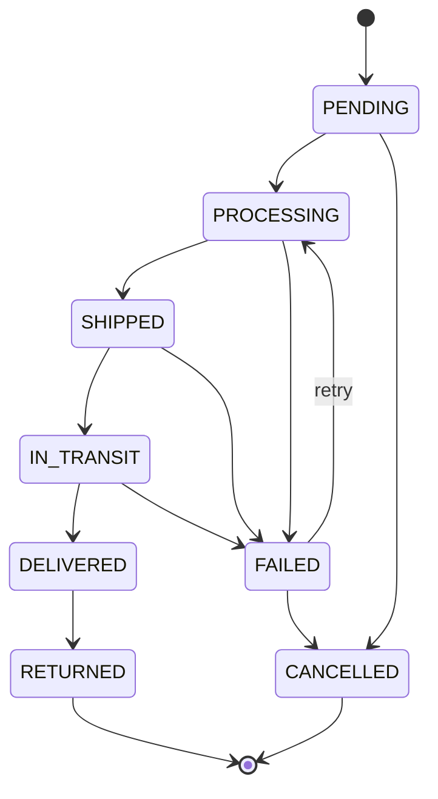

# Order status state machine

The transition table lives in one place: [`backend/src/domain/orderStatus.ts`](../backend/src/domain/orderStatus.ts).
Any transition not listed below is rejected with `409 INVALID_STATUS_TRANSITION`.

| From         | Allowed next statuses                 |
|--------------|---------------------------------------|
| `PENDING`    | `PROCESSING`, `CANCELLED`             |
| `PROCESSING` | `SHIPPED`, `FAILED`                   |
| `SHIPPED`    | `IN_TRANSIT`, `FAILED`                |
| `IN_TRANSIT` | `DELIVERED`, `FAILED`                 |
| `DELIVERED`  | `RETURNED`                            |
| `FAILED`     | `PROCESSING` (retry), `CANCELLED`     |
| `CANCELLED`  | — (final)                             |
| `RETURNED`   | — (final)                             |

A transition to the same status (e.g. `PENDING → PENDING`) is not a transition and is forbidden too.

## Status vs. shipping lock

`PROCESSING` means **"being prepared"** (picked and packed in the warehouse). It does not mean "a courier is being called right now". That is a separate fact, stored separately:

| Field | Meaning |
|---|---|
| `status` | Where the order is in the state machine above. |
| `shippingStartedAt`, `shippingProviderId` | Set while a ship request is waiting for a courier, cleared together with the outcome. Both are set or both are empty (a `CHECK` constraint). |

Why two fields: the demo data has orders in `PROCESSING` that nobody is shipping. If the status were the lock, those orders could never be shipped (`409 SHIPMENT_IN_PROGRESS` with nothing in flight), and the recovery job would turn every one of them into a false `FAILED` "Recovered after interruption".

Shipping (`ShipmentService.ship`):
1. Allowed from `PENDING`, `PROCESSING` and `FAILED`, when the order is paid, has no tracking number and **no shipping lock**.
2. Take the lock in one conditional update: `UPDATE orders SET shipping_started_at = …, status = 'PROCESSING' WHERE id = $1 AND status = <read> AND shipping_started_at IS NULL AND tracking_number IS NULL AND payment_status = 'PAID'`. If no row is updated, another request was faster: read again, and the answer is usually `409 SHIPMENT_IN_PROGRESS`.
   - from `PENDING` or `FAILED` the status moves to `PROCESSING`, recorded as `STATUS_CHANGED` "Shipping requested with …";
   - from `PROCESSING` the status stays, so no event is written at this point (the final event names the courier and the attempts).
3. Call the courier (timeout, retries).
4. Record `SHIPPED` or `FAILED` **and clear the lock** in one conditional update `WHERE shipping_started_at = <the value set in step 2>`, with the event in the same transaction. If the recovery job closed this attempt in the meantime, nothing is overwritten and the request answers `409 SHIPMENT_INTERRUPTED`.

The recovery job looks only at the lock: orders with `shipping_started_at` older than 5 minutes. An order in `PROCESSING` without a lock is never touched, however old it is.

## Order events

Every status change writes one `OrderEvent` ([`backend/src/domain/orderEvent.ts`](../backend/src/domain/orderEvent.ts)) with the same timestamp as the change. It happens in `OrderService.changeStatus()`, so it can't be forgotten on any path (HTTP today, courier webhooks and retries later). A forbidden transition writes nothing.

| Type | Written when | Source |
|---|---|---|
| `ORDER_CREATED` | an order is created (`fromStatus: null → PENDING`) | `api` |
| `STATUS_CHANGED` | any other change, e.g. `PENDING → PROCESSING` when shipping is requested | `api`, `system` |
| `SHIPMENT_CREATED` | the courier accepted the parcel (`PROCESSING → SHIPPED`) | `provider` |
| `SHIPMENT_REJECTED` | the courier refused (`PROCESSING → FAILED`, with its error code) | `provider` |
| `PROVIDER_UNAVAILABLE` | the courier couldn't be reached (`PROCESSING → FAILED`) | `provider` |
| `PAYMENT_RECORDED` | the shop recorded the payment; the status stays the same (`fromStatus = toStatus`) | `api` |
| `STATUS_CHANGED` from a courier webhook | the courier reported the next status | `webhook` |
| `WEBHOOK_IGNORED` | a courier update that couldn't be applied (forbidden transition, unknown status); the status stays the same | `webhook` |

Events are only appended, never changed or deleted. `PAYMENT_RECORDED` and `WEBHOOK_IGNORED` are not status changes (`isStatusChange()`), so the timeline and "Updated today" skip it. The Overview's "Updated today" counts today's events, and the Integrations page lists the three `provider` types. The demo history uses `STATUS_CHANGED` with source `system`, and so does the recovery job (code `SHIPMENT_INTERRUPTED`).

With PostgreSQL the order update and its event are written in **one transaction** (`OrderService` → `RunInTransaction`): either both are stored or neither. The update is conditional (`WHERE status = <what was read>`), so two requests that read the same status can't both change it. A test proves both against a real database, with two app instances and a barrier that makes both requests read before either writes ([`concurrency.test.ts`](../backend/tests/integration/concurrency.test.ts)).
