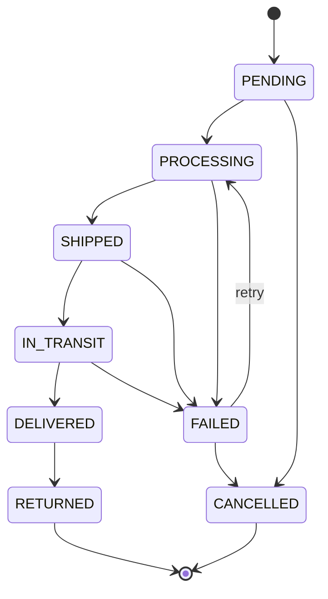

# Order status state machine

The transition table lives in one place: [`backend/src/domain/orderStatus.ts`](../backend/src/domain/orderStatus.ts).
Any transition not listed below is rejected with `409 INVALID_STATUS_TRANSITION`.

| From         | Allowed next statuses                 |
|--------------|---------------------------------------|
| `PENDING`    | `PROCESSING`, `CANCELLED`             |
| `PROCESSING` | `SHIPPED`, `FAILED`                   |
| `SHIPPED`    | `IN_TRANSIT`, `FAILED`                |
| `IN_TRANSIT` | `DELIVERED`, `FAILED`                 |
| `DELIVERED`  | `RETURNED`                            |
| `FAILED`     | `PROCESSING` (retry), `CANCELLED`     |
| `CANCELLED`  | — (final)                             |
| `RETURNED`   | — (final)                             |

A transition to the same status (e.g. `PENDING → PENDING`) is not a transition and is forbidden too.
