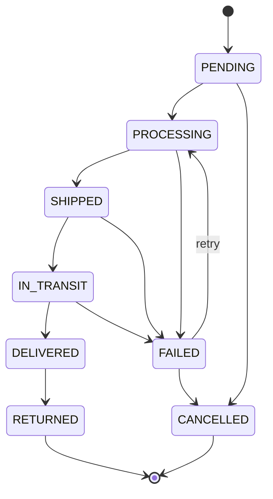

# Order status state machine

The transition table lives in one place: [`backend/src/domain/orderStatus.ts`](../backend/src/domain/orderStatus.ts).
Any transition not listed below is rejected with `409 INVALID_STATUS_TRANSITION`.

| From         | Allowed next statuses                 |
|--------------|---------------------------------------|
| `PENDING`    | `PROCESSING`, `CANCELLED`             |
| `PROCESSING` | `SHIPPED`, `FAILED`                   |
| `SHIPPED`    | `IN_TRANSIT`, `FAILED`                |
| `IN_TRANSIT` | `DELIVERED`, `FAILED`                 |
| `DELIVERED`  | `RETURNED`                            |
| `FAILED`     | `PROCESSING` (retry), `CANCELLED`     |
| `CANCELLED`  | — (final)                             |
| `RETURNED`   | — (final)                             |

A transition to the same status (e.g. `PENDING → PENDING`) is not a transition and is forbidden too.

## Order events

Every status change writes one `OrderEvent` ([`backend/src/domain/orderEvent.ts`](../backend/src/domain/orderEvent.ts)) with the same timestamp as the change. It happens in `OrderService.changeStatus()`, so it can't be forgotten on any path (HTTP today, courier webhooks and retries later). A forbidden transition writes nothing.

| Type | Written when | Source |
|---|---|---|
| `ORDER_CREATED` | an order is created (`fromStatus: null → PENDING`) | `api` |
| `STATUS_CHANGED` | any other change, e.g. `PENDING → PROCESSING` when shipping is requested | `api`, `system` |
| `SHIPMENT_CREATED` | the courier accepted the parcel (`PROCESSING → SHIPPED`) | `provider` |
| `SHIPMENT_REJECTED` | the courier refused (`PROCESSING → FAILED`, with its error code) | `provider` |
| `PROVIDER_UNAVAILABLE` | the courier couldn't be reached (`PROCESSING → FAILED`) | `provider` |
| `PAYMENT_RECORDED` | the shop recorded the payment; the status stays the same (`fromStatus = toStatus`) | `api` |

Events are only appended, never changed or deleted. `PAYMENT_RECORDED` is not a status change (`isStatusChange()`), so the timeline and "Updated today" skip it. The Overview's "Updated today" counts today's events, and the Integrations page lists the three `provider` types. The demo history uses `STATUS_CHANGED` with source `system`. With PostgreSQL (Phase 9), the order update and its event will share one transaction.
